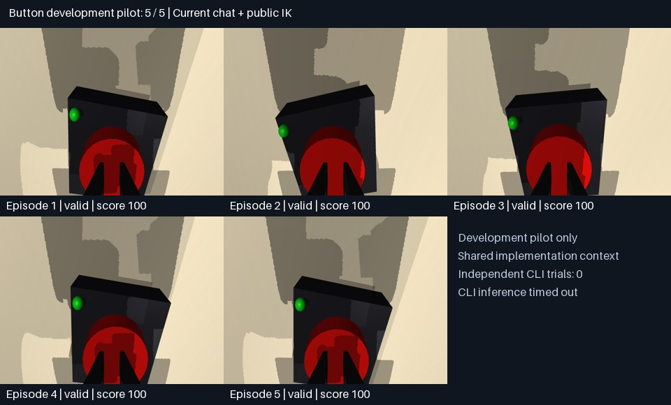

# Button development pilot — 2026-10-23

**Observed result: 5 successes in 5 randomized episodes (100%).** Every episode
was submitted normally, scored 100, and passed an exact physics action replay.
This is a development result for the current chat controller with public-model
IK support, **not an independent GPT/ChatGPT model benchmark**.



## Controller and observations

The current chat model visually selected button centers in overhead RGB images,
converted selected pixels using public camera calibration, and commanded
Cartesian approach targets through the public robot-only IK helper and HTTP
gateway. The model inspected wrist images between descending motions, corrected
one episode's xy alignment, and submitted after seeing a green physical indicator
in all five wrist views. There was no automatic color detector or call to the
existing scripted button policy. Four episodes used 9 motion/wait commands and
one used 12; each used 8 camera observations.

The trusted server generated fresh private random seeds. Neither seeds, current
object poses, nor evaluator output were read during control. Scores were first
reviewed after all five submissions. Subsequently, an operator replayed accepted
actions from the private audit logs and verified exact final qpos, scores, peak
forces, travel, and scene hashes for all five episodes. Ground-truth files and
credentials remain excluded from Git.

| Episode | Valid | Score | Simulated seconds | Result |
|---|---|---|---|---|
| 1 | Yes | 100 | 8.6 | Success |
| 2 | Yes | 100 | 8.6 | Success |
| 3 | Yes | 100 | 8.6 | Success |
| 4 | Yes | 100 | 11.6 | Success after image-based alignment correction |
| 5 | Yes | 100 | 8.6 | Success |

The machine-readable [sanitized report](button-chat-pilot.json) contains usage
and verification results, but no tokens, seeds, or object coordinates.

## Why this is not an independent GPT score

The chat contains benchmark implementation details and the previous scripted
baseline, so prior implementation knowledge can influence the controller. The
five episodes also share the same conversation and controller decisions; they
are not five independent fresh model sessions. Exact runtime model identity and
inference settings were not independently attested. Local process separation
does not enforce adversarial host isolation. Five successful scenes do not
establish broad robotics ability or a reliable population success rate.

The installed Codex CLI reported **Logged in using ChatGPT**. Its inference
header selected `gpt-6.1-sol`, but two minimal inference preflights timed out
(90 s and 45 s) before returning a model answer. Thus **zero independent
subscription-CLI robotics trials completed**. These infrastructure failures
were not counted as robot failures, and this report does not claim a measured
success rate for that model. Codex supports
[ChatGPT sign-in](https://learn.chatgpt.com/docs/codex/cli) and
[noninteractive execution](https://learn.chatgpt.com/docs/developer-commands?surface=cli).

## Repeat an interactive development pilot

```sh
.venv/bin/python scripts/serve_interactive_pilot.py \
  --output private-runs/new-chat-pilot \
  --public-dir /private/tmp/new-chat-pilot --episodes 5
```

Both directories must be new. Give the controller only the public directory,
which contains an allowlisted robot/client bundle and `gateways.json` with
per-episode URL/token pairs. The controller must use `RobotClient` to inspect
and act; the server includes no manipulation policy. All five servers are
serviced on one GL-owning thread. Once every episode terminates, the operator
gets `summary.json` under the private output directory.

For a publishable model comparison, use fresh model contexts with a fixed
prompt and controller contract, record the exact model/settings, run more
held-out layouts, and enforce a separate isolated policy host or VM. Resolve the
CLI inference connectivity issue before reporting a subscription-backed model
success rate.
